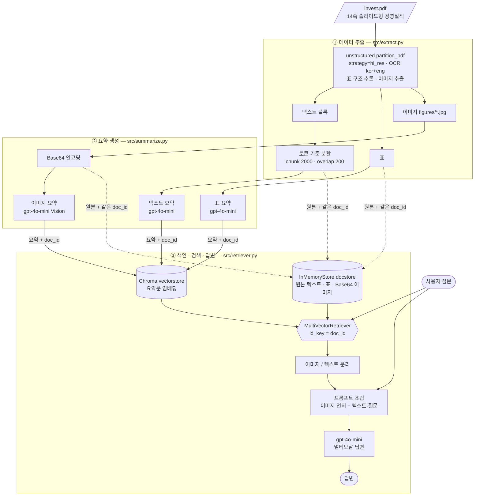
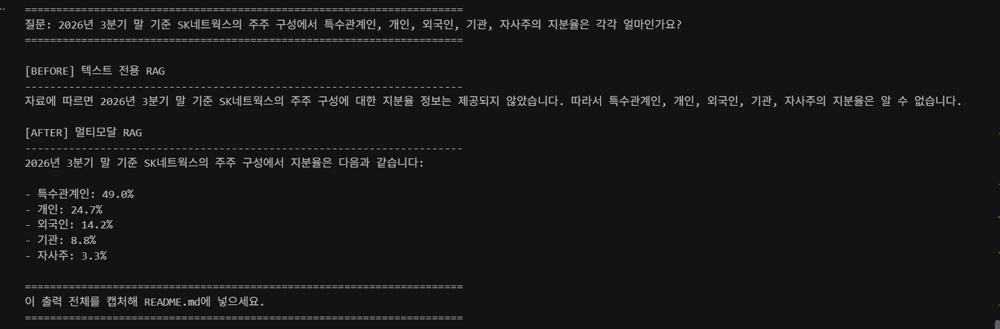

# SK네트웍스 경영실적 멀티모달 RAG

SK네트웍스 *2026년 3분기 경영실적* PDF(`invest.pdf`)에서 **텍스트·표·차트 이미지**를 모두 검색해 답하는 멀티모달 질의응답 시스템입니다.
텍스트만 다루는 RAG와 비교(Before/After)해, 차트 속 숫자를 얼마나 더 잘 답하는지 확인합니다.

- 제출 노트북: [`notebooks/Multi_modal_RAG.ipynb`](notebooks/Multi_modal_RAG.ipynb)
- 아키텍처 다이어그램: 아래 [2. 아키텍처](#2-아키텍처)
- GitHub : [`GitHub`](https://github.com/clipnpaper/multimodal-rag)
---

## 1. 문제 정의

### 대상 자료의 특성
`invest.pdf`는 14쪽짜리 **슬라이드형 실적 발표 자료**입니다.

| 특성 | 내용 |
|---|---|
| 본문이 적다 | 추출된 텍스트는 약 4천 자. 장문 서술이 거의 없다 |
| 핵심 수치가 그래프에 있다 | 분기별 매출·영업이익 막대 차트, 호텔 객실 점유율, 주주 구성 도넛 차트 등 |
| 표가 많다 | 사업부문별 영업실적, 재무상태표, 투자 내역 |
| 한국어 + 숫자 | 한글 라벨과 `△`(감소) 같은 표기가 섞여 있다 |

### 왜 텍스트 전용 RAG로는 부족한가
"외국인 지분율은 몇 %인가요?", "2025년 3분기 객실 점유율은?" 같은 질문의 답은 **차트 이미지 안에만** 있습니다.
PDF에서 텍스트만 뽑으면 이 숫자는 아예 색인되지 않아, 모델이 "자료에 없다"고 답하거나 다른 숫자를 지어냅니다.

### 목표
1. PDF에서 **텍스트·표·이미지**를 모두 추출한다.
2. 각각을 **검색 가능한 한국어 요약**으로 바꿔 색인한다.
3. 질문에 걸린 요약의 **원본(특히 차트 이미지)** 을 멀티모달 LLM에 전달해 근거 있는 답을 만든다.
4. 텍스트 전용 RAG와 같은 조건에서 비교한다.

---

## 2. 아키텍처

**다중 벡터 검색(Multi-Vector Retriever)** 구조입니다. 요약으로 찾고, 원본으로 답합니다.



### 왜 "요약으로 검색하고, 원본으로 생성"하는가
- **검색은 요약으로.** 차트 이미지는 그대로는 글로 된 질문과 비교할 수 없습니다. 그래서 이미지를 한국어 요약문으로 바꿔 벡터화하고, 질문과 요약의 유사도로 찾습니다. 도서관의 **색인 카드**와 같습니다.
- **생성은 원본으로.** 요약은 압축된 정보라 숫자가 빠지거나 틀릴 수 있습니다. 검색된 요약의 `doc_id`로 docstore에서 **원본**을 꺼내 LLM에 주면, 모델이 요약이 아니라 **실제 차트 이미지**를 보고 수치를 읽습니다. 색인 카드로 찾은 뒤 **서가에서 진짜 책**을 꺼내는 것과 같습니다.
- 둘을 잇는 것이 `doc_id`입니다. 요약과 원본에 **같은 번호표**를 붙여 저장합니다.

---

## 3. 기술 선택 근거

| 항목 | 선택 | 근거 |
|---|---|---|
| PDF 추출 | `unstructured` `hi_res` + `languages=["kor","eng"]` | 레이아웃 분석으로 표·이미지를 따로 뽑을 수 있다. 한국어 OCR을 지정하지 않으면 영어로만 인식해 글자가 깨진다 |
| 텍스트 분할 | 토큰 기준 `chunk_size=2000`, `chunk_overlap=200` | 문자 수 대신 토큰 기준이라 LLM 입력 한도와 일치한다. overlap 200으로 경계에서 문맥이 끊기는 것을 줄인다. 본문이 약 4천 자뿐이라 결과는 2~3청크다 |
| 요약·답변 모델 | `gpt-4o-mini` (temperature 0) | 텍스트와 이미지를 모두 처리하는 멀티모달 모델이고, 저렴하고 빨라 이미지 49장을 요약하는 비용이 작다. temperature 0으로 같은 질문에 일관된 답을 얻는다 |
| 임베딩 | `text-embedding-3-small` | 한국어를 지원하고 저렴하다. 요약문은 짧아 소형 모델로 충분하다 |
| 벡터 DB / 원본 저장소 | Chroma + `InMemoryStore` | 과제 규모에서는 별도 서버 없이 동작한다. 요약(검색용)과 원본(전달용)을 분리 보관한다 |
| 텍스트·표 요약 프롬프트 | **한국어** | 문서와 질문이 모두 한국어이므로 요약도 한국어여야 질문과 임베딩 공간이 맞는다 |
| 이미지 요약 프롬프트 | **영어 지시 + "한국어(Hangul)로 작성"** | 영어 지시는 모델이 안정적으로 따르고, 출력은 한국어로 지정해 질문과 같은 언어로 색인되게 한다 |
| 답변 프롬프트 | 한국어, "자료에 없는 내용은 모른다고 답하세요" | 근거 없는 추측(환각)을 줄이고 근거 중심 답변을 유도한다 |
| 이미지 전달 순서 | 이미지를 텍스트보다 먼저 | 모델이 그림을 먼저 보고 질문을 읽게 한다 |

---

## 4. 실행 방법

### 사전 준비 (Python 패키지가 아닌 OS 프로그램)
| 프로그램 | 용도 | 비고 |
|---|---|---|
| Python 3.11 | 실행 환경 | 3.11.9 에서 검증 |
| Poppler | PDF → 이미지 변환 | `pdftoppm` 이 PATH 에서 실행되어야 함 |
| Tesseract OCR + 한국어(kor) 언어 데이터 | OCR | `tesseract` 가 PATH 에서 실행되어야 함 |

| OS | 설치 방법 |
|---|---|
| Windows | [Poppler](https://github.com/oschwartz10612/poppler-windows) 압축 해제 후 `bin` 을 PATH 에 추가 · [Tesseract](https://github.com/UB-Mannheim/tesseract/wiki) 설치 시 **Korean** 언어 데이터 선택 후 PATH 추가 |
| macOS | `brew install poppler tesseract tesseract-lang` |
| Ubuntu/Debian | `sudo apt install poppler-utils tesseract-ocr tesseract-ocr-kor` |

`tesseract --list-langs` 에 `kor` 가 보여야 합니다. (노트북 첫 셀도 이를 확인합니다.)

### 설치
```bash
git clone https://github.com/clipnpaper/multimodal-rag
cd multimodal-rag

# 가상환경 생성 및 활성화
python -m venv .venv
source .venv/bin/activate          # 윈도우: .venv\Scripts\activate

# 의존성 설치
pip install --upgrade pip
pip install -r requirements.txt     # 권장. 정확히 같은 버전이 필요하면 requirements.lock.txt (Windows 기준 고정)

# 커널 등록
python -m ipykernel install --user --name multimodal-rag
```

### API 키 설정
```bash
cp .env.example .env                # 윈도우: copy .env.example .env
```
`.env` 를 열어 `OPENAI_API_KEY` 에 본인 키를 입력합니다. `.env` 는 `.gitignore` 로 커밋되지 않습니다.

### PDF 배치
원본 PDF는 저장소에 포함되어 있습니다.

```
data/invest.pdf
```

다른 PDF로 바꾸려면 노트북 2장 "경로 설정" 셀의 `fname` 만 수정하세요.

### 실행
1. `jupyter lab` 으로 [`notebooks/Multi_modal_RAG.ipynb`](notebooks/Multi_modal_RAG.ipynb)를 엽니다.
2. 커널을 `multimodal-rag` 로 선택하고 **Restart & Run All** 을 실행합니다.
3. 실행 중 `data/figures/`(추출 이미지), `data/processed/`(중간 산출물 pkl)가 자동 생성됩니다.
4. 마지막 셀이 질의 5건의 결과를 `notebooks/results.md` 로 저장합니다.

> **참고**
> - 첫 실행 시 `unstructured` 가 레이아웃 분석 모델 등을 내려받으므로 **인터넷 연결**이 필요하고, 추출 셀(`hi_res`)에 몇 분이 걸립니다.
> - 이미지 요약과 질의에 OpenAI API가 호출되므로 비용이 발생합니다. 색인 셀을 두 번 실행하면 벡터 DB에 데이터가 중복됩니다.
> - 노트북은 위에서부터 **순서대로(Run All)** 실행해야 합니다. `.env` 가 없으면 3장 첫 셀에서 안내 메시지와 함께 멈춥니다.
> - Windows 에서 추출 중 `WinError 32` (임시 파일 사용 중) 가 나면 해당 셀만 다시 실행하세요.

### 프로젝트 구조
```
multimodal-rag/
├── .venv/                      # 가상환경 (Git 제외)
├── .env                        # API 키 (Git 제외, 절대 커밋 금지)
├── .env.example                # 키 없는 템플릿 (Git 포함)
├── .gitignore
├── requirements.txt            # 의존성 목록
├── requirements.lock.txt       # 버전 고정 파일
├── README.md
├── data/
│   ├── invest.pdf              # 원본 PDF (SK네트웍스 2026년 3분기 경영실적)
│   ├── figures/                # 추출된 이미지 (Git 제외, 용량 큼)
│   └── processed/              # 중간 산출물 pkl (Git 제외)
├── notebooks/
│   └── Multi_modal_RAG.ipynb   # 제출 노트북 (추출 → 요약 → 검색·체인 → 비교)
└── src/
    ├── extract.py              # ① PDF 파싱: 추출 · 분류 · 텍스트 분할
    ├── summarize.py            # ② 요약 체인: 텍스트·표·이미지 요약
    └── retriever.py            # ③ 다중 벡터 검색기 · 최종 체인 · 텍스트 전용 체인
```

### 모듈 역할
| 모듈 | 주요 함수 | 노트북 대응 |
|---|---|---|
| `src/extract.py` | `extract_pdf_elements`, `categorize_elements`, `split_texts` | 1. 데이터 추출 |
| `src/summarize.py` | `generate_text_summaries`, `encode_image`, `image_summarize`, `generate_img_summaries` | 2. 요약 생성 |
| `src/retriever.py` | `create_retriever`, `add_documents`, `split_image_text_types`, `img_prompt_func`, `build_multimodal_chain`, `build_text_only_chain` | 3. 다중 벡터 검색기 + 최종 체인 |

노트북은 이 모듈을 불러와 단계별로 실행하고 결과를 확인하는 역할을 합니다.

---

## 5. Before / After 비교 — 텍스트 RAG vs 멀티모달 RAG

**조건을 같게 했습니다.** 같은 모델(`gpt-4o-mini`), 같은 임베딩, 같은 프롬프트, 같은 `k=4`. 다른 점은 **이미지·표 요약을 색인에 넣었는지** 하나뿐입니다.

| | Before: 텍스트 전용 RAG | After: 멀티모달 RAG |
|---|---|---|
| 색인 대상 | 추출한 텍스트 청크만 | 텍스트 + 표 + 이미지 요약 |
| LLM에 전달 | 텍스트 | 텍스트 + **원본 이미지** |

질문: `2026년 3분기 말 기준 SK네트웍스의 주주 구성에서 특수관계인, 개인, 외국인, 기관, 자사주의 지분율은 각각 얼마인가요?`
(정답은 4쪽 도넛 차트: 특수관계인 49.0%, 개인 24.7%, 외국인 14.2%, 기관 8.8%, 자사주 3.3%)



### 차이 설명

텍스트 전용 RAG는 이미지 안에 쓰여진 데이터를 청킹하지 못해 모른다고 답한 대신,
멀티모달 RAG는 이미지 안에 쓰여진 데이터를 청킹해 그에 대한 지식으로 답했다.

---

## 6. 질의응답 5건

차트 이미지 안에만 있는 수치를 묻는 질문 5건입니다. 같은 질문을 텍스트 전용 RAG(Before)와 멀티모달 RAG(After)에 던졌습니다. (실행 결과는 노트북 마지막 셀 출력)

| # | 질문 | 정답(원문) | Before (텍스트 전용) | After (멀티모달) | 근거가 된 원본 종류 | After 정답 |
|---|---|---|---|---|---|---|
| 1 | 2026년 3분기 말 기준 SK네트웍스의 외국인 지분율과 자사주 지분율은 각각 몇 %인가요? | 외국인 14.2%, 자사주 3.3% | 자료에 외국인 지분율과 자사주 지분율에 대한 내용이 포함되어 있지 않으므로, 해당 정보는 알 수 없습니다. | 2026년 3분기 말 기준 SK네트웍스의 외국인 지분율은 14.2%이고, 자사주 지분율은 3.3%입니다. | 이미지 (4쪽 주주구성 도넛 차트) | ○ |
| 2 | 워커힐 호텔의 객실, F&B, 호텔 기타 부문의 2026년 3분기 매출은 각각 몇 억 원인가요? | 객실 198억원, F&B 375억원, 호텔 기타 55억원 | 자료에 따르면, 2026년 3분기 워커힐 호텔의 객실 매출은 835억 원, F&B 매출은 627억 원입니다. 호텔 기타 부문에 대한 매출 정보는 제공되지 않았습니다. | 워커힐 호텔의 2026년 3분기 매출은 다음과 같습니다:<br><br>- 객실: 198억 원<br>- F&B: 375억 원<br>- 호텔 기타: 55억 원 | 이미지 (11쪽 호텔 사업별 매출 차트) | ○ |
| 3 | 워커힐 호텔의 2025년 3분기 객실 평균 점유율은 몇 %였나요? | 80.3% | 자료에 따르면, 워커힐 호텔의 2025년 3분기 객실 평균 점유율에 대한 정보는 포함되어 있지 않습니다. 따라서 해당 질문에 대한 답변을 드릴 수 없습니다. | 워커힐 호텔의 2025년 3분기 객실 평균 점유율은 80.3%였습니다. | 이미지 (11쪽 객실 평균 점유율 차트) | ○ |
| 4 | SK인텔릭스(렌탈 사업)의 분기별 매출 중 가장 높았던 분기는 언제이고, 금액은 얼마인가요? | 2026년 1분기(’26.1Q), 2,218억원 | 자료에 따르면 SK인텔릭스(렌탈 사업)의 분기별 매출 중 가장 높았던 분기는 2026년 1분기이며, 금액은 14,408억 원입니다. | 자료에 따르면 SK인텔릭스(렌탈 사업)의 분기별 매출 중 가장 높았던 분기는 '26.3Q'이며, 금액은 909억 원입니다. | 이미지 (9쪽 SK인텔릭스 매출 차트) | ✕ |
| 5 | SK인텔릭스(렌탈 사업)의 2025년 4분기 매출과 영업이익은 각각 얼마인가요? | 매출 2,035억원, 영업이익 12억원 | 자료에 따르면 SK인텔릭스(렌탈 사업)의 2025년 4분기 매출과 영업이익에 대한 정보는 제공되지 않았습니다. 따라서 해당 질문에 대한 답변을 드릴 수 없습니다. | 자료에 해당 내용이 없으므로, SK인텔릭스(렌탈 사업)의 2025년 4분기 매출과 영업이익은 알 수 없습니다. | 이미지 (9쪽 SK인텔릭스 매출·영업이익 차트) | ✕ |

- **Before 는 5건 모두 답하지 못하거나 다른 표의 숫자를 잘못 가져왔습니다.** 정답이 이미지에만 있기 때문입니다.
- **After 는 1~3번을 정확히 맞혔습니다.** 검색된 차트 이미지를 직접 읽었기 때문입니다.
- **4~5번은 After 도 실패했습니다.** 해당 차트의 이미지 요약이 "수익 추세 그래프"처럼 모호해 SK인텔릭스 차트가 검색되지 않은 것으로 보입니다(7장 한계 3번).

---

## 7. 한계

실제 실행하며 확인한 한계입니다.

1. **한국어 OCR 품질.** 슬라이드 레이아웃과 작은 글씨 때문에 표와 본문이 깨져 추출됩니다(예: 투자 내역 표의 금액 열 누락, 글자 사이 공백). OCR 의존이 큰 표 질문은 정확도가 낮습니다. 언어를 `eng` 로만 두면 글자가 훨씬 심하게 깨집니다.
2. **이미지 잘림.** 추출된 차트 이미지는 위·아래가 잘려 제목이나 일부 막대의 값 라벨이 사라지는 경우가 있습니다(예: 글로벌 렌탈 계정 차트의 ’26.3Q 값). 이미지에 없는 값은 모델이 지어낼 수 있습니다.
3. **이미지 요약 품질이 검색 품질을 결정.** 요약이 "수익 추세 그래프"처럼 모호하면 질문과 매칭되지 않거나 엉뚱한 차트가 검색됩니다. 요약 단계에서 숫자 오독도 발생합니다.
4. **장식 이미지 노이즈.** 추출 이미지 49장 중 상당수가 로고·페이지 번호 같은 장식입니다. 벡터 DB에 노이즈로 들어가 검색 순위를 흐립니다.
5. **소형 모델의 비교·추론 한계.** `gpt-4o-mini` 는 차트의 여러 수치를 비교해 "가장 높은 값"을 고르는 질문에서 틀릴 수 있습니다.
6. **휘발성 저장소.** Chroma(인메모리)와 `InMemoryStore` 는 커널을 끄면 사라집니다. 재실행 시 요약 pkl을 다시 읽어 색인을 새로 만듭니다.
7. **단일 문서.** 한 개의 PDF만 대상으로 평가했습니다.

### 개선 방향
- 이미지 요약 프롬프트를 "차트 제목, 항목명, 단위, 모든 수치를 옮겨 적기"로 바꿔 검색 가능성을 높인다.
- 작은 이미지(로고)를 걸러 색인에서 제외한다.
- 차트 크롭 시 여백을 넓히거나, 슬라이드 전체 페이지 이미지를 함께 색인한다.
- 이미지 요약과 최종 답변에 더 큰 모델을 쓴다.
- Chroma `persist_directory` 로 색인을 영속화한다.

---

## 8. 보안 처리

- API 키는 `.env` 에만 두고 `python-dotenv` 로 읽습니다. 코드와 노트북에 키를 직접 쓰지 않았습니다.
- `.gitignore` 로 `.env`, `.env.*`(단 `.env.example` 제외), `.venv/`, 추출 이미지, 피클, 벡터 DB를 제외했습니다. 과제 대상 PDF(`data/invest.pdf`)만 예외로 포함합니다.
- 저장소에는 키 자리표시자만 있는 `.env.example` 만 올립니다.
- 커밋 이력에 `.env` 가 포함된 적이 없음을 확인했습니다(`git log --all -- .env` 결과 없음).
