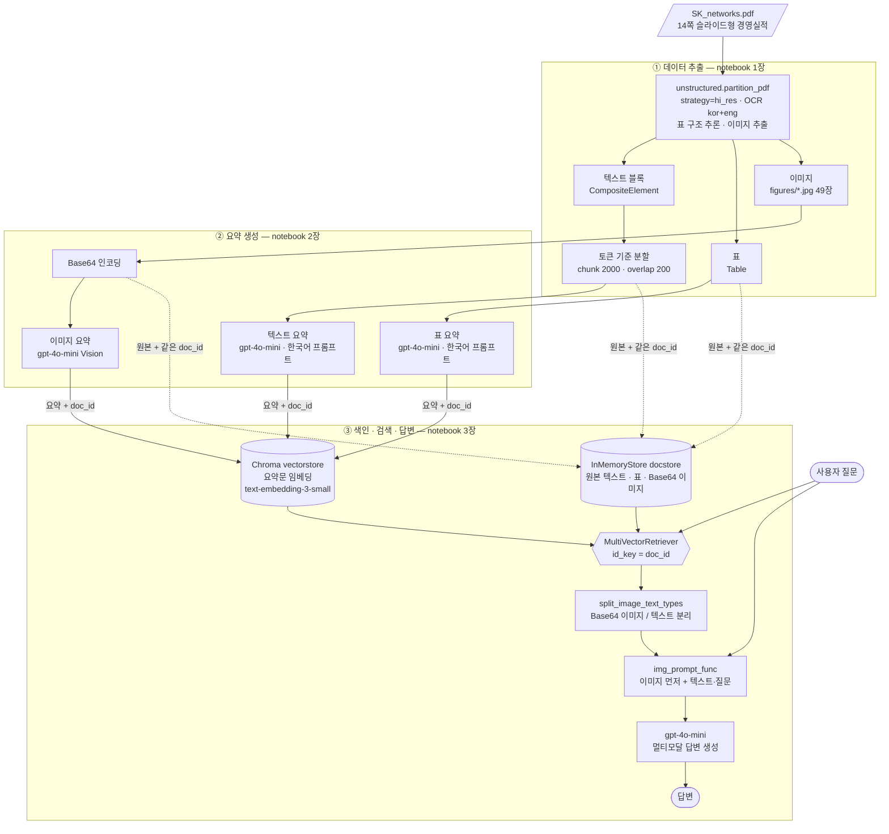

# 아키텍처 다이어그램

SK네트웍스 *2026년 3분기 경영실적* PDF(`SK_networks.pdf`)를 대상으로 한 **다중 벡터(Multi-Vector) 멀티모달 RAG**의 전체 흐름입니다.
파이프라인은 **① 데이터 추출 → ② 요약 생성 → ③ 색인·검색·답변** 3단계로 나뉩니다.

## 읽는 법

| 선 | 의미 |
|---|---|
| 실선 | 데이터 흐름 |
| 점선 | 원본을 docstore에 보관하는 경로 (요약과 **같은 `doc_id`** 를 붙여 저장) |

## 핵심 아이디어: "요약으로 찾고, 원본으로 답한다"

- **검색은 요약으로** 합니다. 차트·표 이미지는 그대로는 임베딩해서 글로 검색할 수 없으므로, 먼저 한국어 요약문으로 바꿔 벡터화합니다.
- **답변은 원본으로** 합니다. 요약에는 숫자가 빠지거나 틀릴 수 있으므로, 검색에 걸린 요약의 `doc_id`로 docstore에서 **원본(텍스트·표·이미지)** 을 꺼내 LLM에 줍니다.
- 이 때문에 멀티모달 LLM은 요약이 아니라 **실제 차트 이미지**를 보고 수치를 읽습니다.

## 질의 시 흐름 (3단계 중 ③)

1. 질문을 임베딩해 Chroma에서 **요약문**과 가까운 항목을 찾는다.
2. 각 요약의 `doc_id`로 docstore에서 **원본**을 꺼낸다.
3. 원본을 정규식으로 **이미지(Base64)** 와 **텍스트/표**로 나눈다.
4. 이미지를 먼저, 그 뒤에 질문과 참고 텍스트를 넣어 `HumanMessage`를 만든다.
5. `gpt-4o-mini`가 답변을 생성한다.
